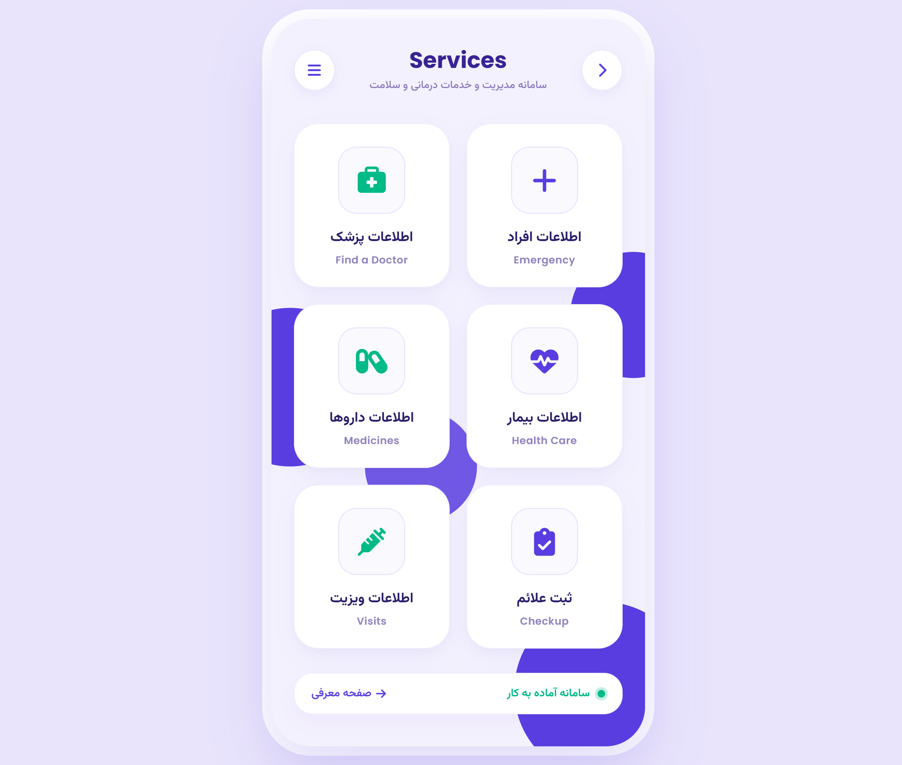
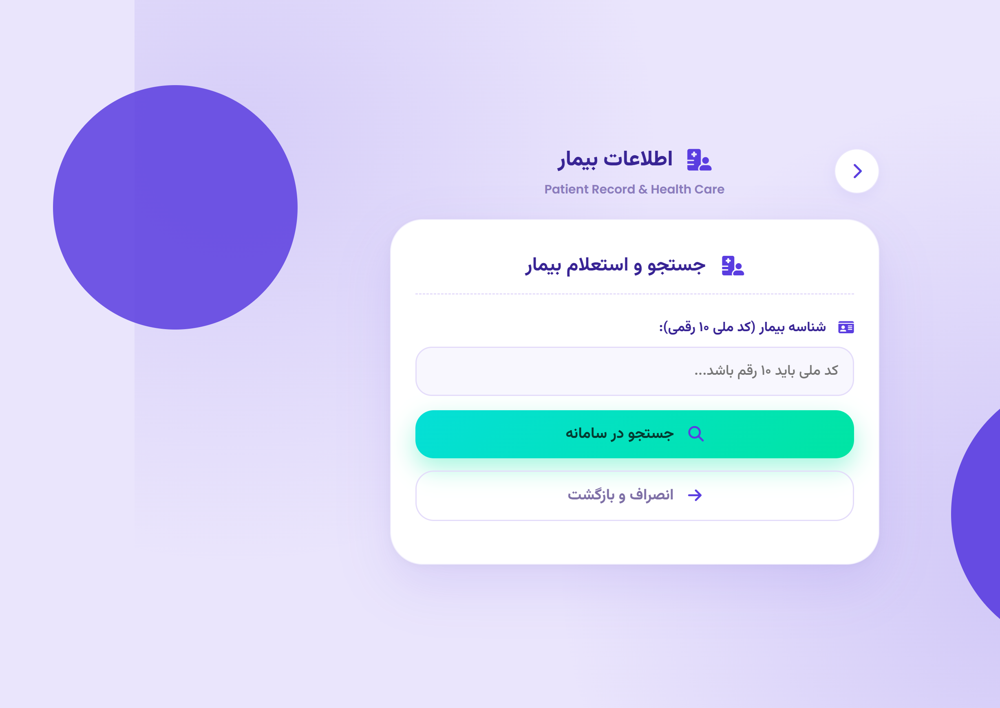
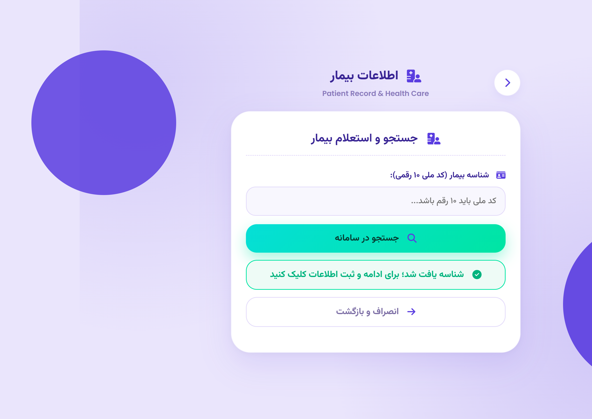
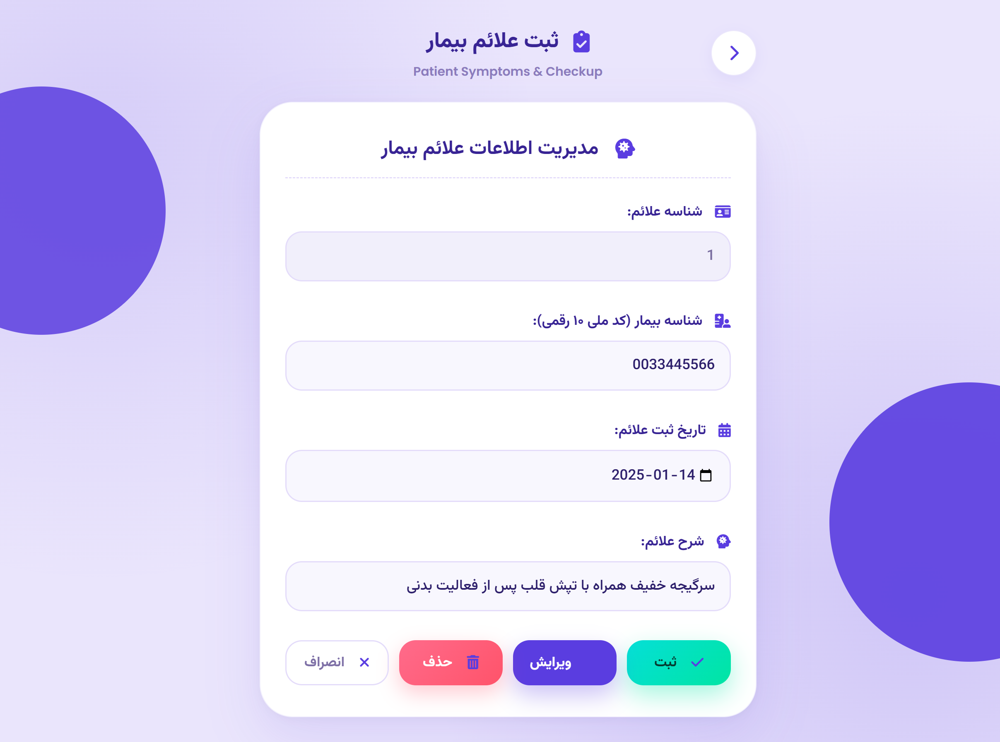

# 🏥 سامانه جامع مدیریت خدمات درمانی و سلامت (Medical Services System)

> [!TIP]
> ### 🌐 مشاهده نسخه آنلاین (Live Demo)
> نسخه دمو آنلاین پروژه به صورت خودکار با داکر بر روی سرور ابری Render و متصل به دیتابیس ابری مستقر شده است:  
> 👉 **[ورود به سامانه آنلاین درمانگاه (Live Demo)](https://book-store-qqh0.onrender.com/)**
> 
> * **نکته برای کاربران داخل ایران:** لطفاً در زمان باز کردن نسخه آنلاین، **فیلترشکن (VPN)** خود را روشن نگه دارید.
> * **زمان بارگذاری اولیه (Cold Start):** به دلیل استفاده از پلن رایگان سرور Render، در صورتی که سرویس در حالت آماده‌باش (Sleep) باشد، لود اولیه ممکن است بین **۳۰ تا ۴۰ ثانیه** طول بکشد؛ لطفاً تا بارگذاری کامل شکیبا باشید.

---

## 📸 تصاویر محیط برنامه (Screenshots)

| تصویر پیش‌نمایش | بخش و توضیحات |
| :---: | :--- |
|  | **صفحه ورودی و اسپلش متحرک (Welcome Portal):**<br>طراحی بنفش مدرن با آیکون‌های وکتور شناور و ترنزیشن انیمیشنی به منوی خدمات. |
|  | **داشبورد خدمات ۲ ستونه (Services Menu):**<br>دسترسی سریع به ۶ بخش درمانی با پس‌زمینه اسطوخودوسی و پترن‌های ارگانیک. |
|  | **فرم استعلام و جستجوی رکورد:**<br>استعلام سریع با اعتبارسنجی کد ملی ۱۰ رقمی و پترن‌های ورودی. |
|  | **تأییدیه یافتن اطلاعات:**<br>نمایش دکمه هدایت هوشمند به فرم مدیریت در صورت وجود رکورد. |
|  | **فرم کامل مدیریت اطلاعات پرونده:**<br>فیلدهای استایل‌دهی‌شده، دسته‌بندی آدرس و دکمه‌های کامل عملیات CRUD. |
|  | **بازخورد تعاملی موفقیت (SweetAlert2):**<br>نمایش پیام‌های شفاف فارسی پس از ثبت، ویرایش یا حذف. |
|  | **مدیریت خطاهای سیستم:**<br>هشدارهای بصری دقیق در صورت بروز خطا در اعتبارسنجی یا پایگاه داده. |

---

## 🌟 قابلیت‌های کلیدی سامانه

- 🟣 **صفحه اسپلش و ورود متحرک (`index.html`):** الهام‌گرفته از اسکرین بنفش نئومدرن با آیکون‌های وکتور و ترنزیشن روان به داشبورد اصلی.
- 📱 **داشبورد کارتی ۲ ستونه (`menu.html`):** ساختار تمیز ۶ گانه خدمات کلینیک با هاور افکت‌های جذاب.
- 👨‍⚕️ **مدیریت اطلاعات افراد و پزشکان (`person.php` و `doctor.php`):** ثبت کد ملی، مشخصات هویتی، سوابق کاری و تخصص‌های درمانی.
- 🩺 **پرونده الکترونیک بیمار و پایش علائم (`patient.php` و `healthstatue.php`):** ثبت سن، سوابق بیماری و تاریخچه ثبت علائم روزانه.
- 💊 **مدیریت جلسات ویزیت و نسخه‌های دارویی (`visit.php` و `medicine.php`):** ثبت تاریخ ویزیت‌ها و تخصیص داروها با کلیدهای خارجی ارتباطی.
- ⚡ **معماری پایگاه داده امن با ۲۴ پرسیجر (Stored Procedures):** اجرای بهینه عملیات با رویه‌های ذخیره‌شده و کلیدهای خارجی با قابلیت حذف و ویرایش آبشاری (`CASCADE`).
- 🔐 **مدیریت امن رمز دیتابیس:** تفکیک متغیرهای حساس و پشتیبانی کامل از `Environment Variables` و فایل محلی ایگنور شده.

---

## 🛠 تکنولوژی‌های استفاده‌شده

- **سمت سرور (Backend):** PHP 8.2 با اکستنشن‌های `mysqli` و `pdo_mysql`
- **پایگاه داده (Database):** MySQL 8.4 (با ۲۴ پرسیجر ذخیره‌شده، کلیدهای خارجی و ویوها)
- **وب‌سرور و کانتینرسازی:** وب‌سرور Apache به همراه Docker و Dockerfile
- **طراحی فرانت‌اند (UI/UX):** HTML5 ،CSS3 ریسپانسیو با پالت اختصاصی (بنفش عمیق سلطنتی، سبز نعنایی نئون، پس‌زمینه اسطوخودوسی)
- **فونت و آیکون‌ها:** فونت فارسی وزیرمتن (Vazirmatn)، فونت انگلیسی Poppins، کتابخانه FontAwesome 6
- **اعلان‌ها:** SweetAlert2 فارسی

---

## 🌲 درخت ساختار فایل‌های پروژه (Tree Structure)

```text
clinic_DB_forms/
├── .dockerignore              # لیست فایل‌های مستثنی‌شده از ایمیج داکر
├── .gitignore                # لیست فایل‌های حساس و محلی گیت
├── Dockerfile                # فایل تنظیمات داکر (PHP 8.2 + Apache)
├── health_check.sql          # اسکریپت جامع ساخت دیتابیس، جداول، پرسیجرها و داده‌های تستی
├── README.md                 # راهنمای کامل، دمو آنلاین و مستندات سامانه
├── dbdiag.png                # نمودار ارتباطی پایگاه داده (ER Diagram)
├── screenshots/              # تصاویر و اسکرین‌شات‌های محیط برنامه
│   ├── welcome.png
│   ├── menu.png
│   ├── search_sample.png
│   ├── success_search_sample.png
│   ├── form_sample.png
│   ├── success_message_ sample.png
│   └── error_message_ sample.png
└── main/                     # سورس‌کد اصلی برنامه وب (بارگذاری در روت آپاچی)
    ├── index.html            # صفحه معرفی و اسپلش انیمیشنی ورودی
    ├── menu.html             # منوی اصلی و داشبورد خدمات
    ├── style.css             # استایل‌شیت مدرن و سراسری سامانه
    ├── person.php            # ثبت، جستجو و مدیریت مشخصات افراد
    ├── doctor.php            # پرونده و سوابق پزشکان
    ├── patient.php           # پرونده پزشکی بیماران
    ├── medicine.php          # مدیریت نسخه‌ها و اقلام دارویی
    ├── visit.php             # زمان‌بندی و ثبت اطلاعات ویزیت‌ها
    ├── healthstatue.php      # ثبت و بررسی علائم بیماران
    └── secret_key.php        # کلید دیتابیس در محیط لوکال (ایگنور در گیت)
```

---

## 🚀 راهنمای نصب و اجرای لوکال

### روش اول: اجرا با WampServer یا XAMPP

1. **انتقال فایل‌ها:**  
   پوشه محتویات `main/` را در دایرکتوری وب‌سرور خود کپی کنید:
   - در XAMPP: مسیر `C:\xampp\htdocs\clinic`
   - در Wamp: مسیر `C:\wamp64\www\clinic`
2. **ساخت پایگاه داده:**  
   - نرم‌افزار **MySQL Workbench** یا **phpMyAdmin** را باز کنید.
   - فایل `health_check.sql` را باز کرده و با کلیک روی آیکون ⚡ **Execute** اجرا کنید تا دیتابیس `health_check`، جداول، پرسیجرها و داده‌های آزمایشی ایجاد شوند.
3. **تنظیم اطلاعات اتصال:**  
   در فایل‌های PHP واقع در `main/`، در صورت استفاده از دیتابیس لوکال، مشخصات کاربری را با سرور خود مطابقت دهید:
   ```php
   $servername = "localhost";
   $username   = "root";
   $password   = ""; // رمز لوکال شما
   $dbname     = "health_check";
   ```
4. **اجرا در مرورگر:**  
   سرویس‌های Apache و MySQL را فعال کرده و آدرس زیر را باز کنید:
   ```text
   http://localhost/clinic/
   ```

---

### روش دوم: اجرا با Docker (کانتینر داکر)

پروژه دارای فایل‌های `Dockerfile` و `.dockerignore` استاندارد است. برای بیلد و اجرای خودکار، کافیست در ریشه پروژه دستورات زیر را در ترمینال اجرا کنید:

```bash
# بیلد کردن ایمیج داکر
docker build -t clinic-app .

# اجرای کانتینر روی پورت ۸۰۸۰
docker run -d -p 8080:80 \
  -e DB_HOST=آدرس_هاست_دیتابیس \
  -e DB_USER=نام_کاربری \
  -e DB_PASS=رمز_عبور \
  -e DB_NAME=نام_دیتابیس \
  -e DB_PORT=پورت \
  --name clinic-container clinic-app
```

سپس با باز کردن مرورگر در آدرس `http://localhost:8080` سامانه اجرا خواهد شد.

---

## 🧪 حساب‌های کاربری و داده‌های پیش‌فرض جهت تست (Seed Data)

پس از راه‌اندازی، رکوردهای زیر در دیتابیس موجود بوده و می‌توانید در بخش‌های مختلف جستجو و استعلام کنید:

| دسته‌بندی | کد ملی / شناسه تست | نام و مشخصات ثبت‌شده | توضیحات رکورد |
| :--- | :--- | :--- | :--- |
| **پزشک** | `0011223344` | دکتر علی محمدی | متخصص قلب و عروق - ۱۵ سال سابقه کار |
| **پزشک** | `0022334455` | دکتر سارا احمدی | متخصص مغز و اعصاب - ۱۰ سال سابقه کار |
| **بیمار** | `0033445566` | رضا رضایی | سن: ۲۹ - سابقه میگرن و فشار خون |
| **بیمار** | `0044556677` | مریم کاظمی | سن: ۲۴ - حساسیت دارویی به پنی‌سیلین |
| **ویزیت** | شناسه عددی: `1` | بیمار رضا رضایی / پزشک علی محمدی | تاریخ ثبت‌شده در پرونده |
| **دارو** | شناسه عددی: `1` | قرص پروپرانولول ۲۰ میلی‌گرم | متصل به شناسه ویزیت ۱ |
| **علائم** | شناسه عددی: `1` | سرگیجه خفیف همراه با تپش قلب | مربوط به بیمار 0033445566 |

---

## 📄 لایسنس و حقوق استفاده

این پروژه برای اهداف آموزشی و توسعه سیستم‌های مراقبت سلامت پیاده‌سازی شده است. استفاده و توسعه آن با رعایت حقوق سازندگان آزاد است.
